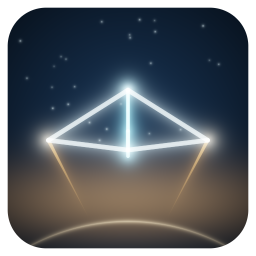
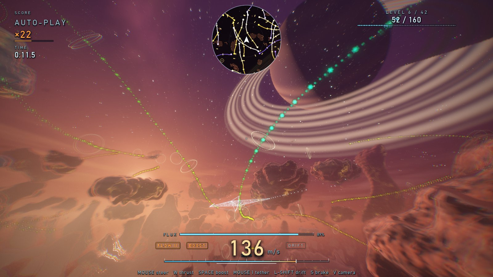
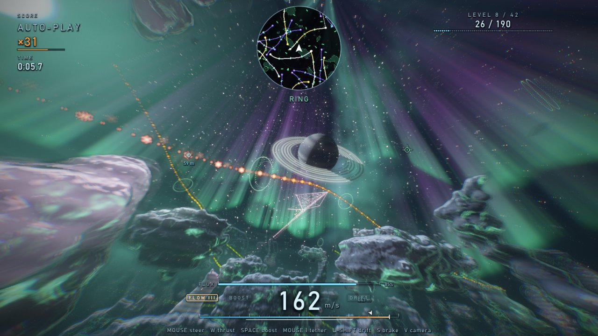
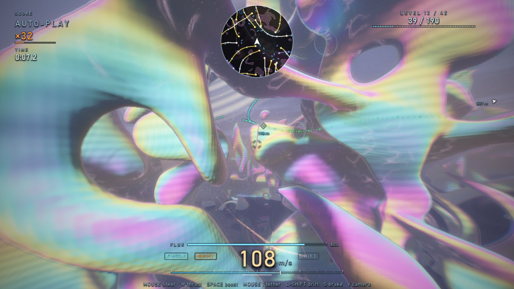
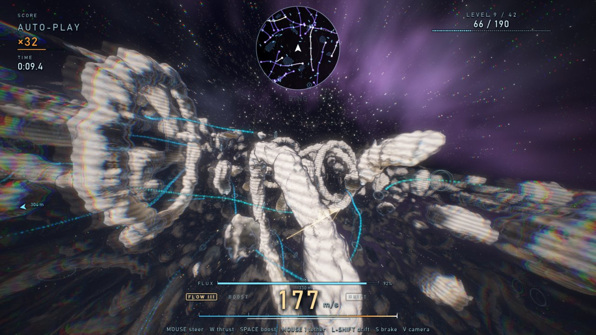
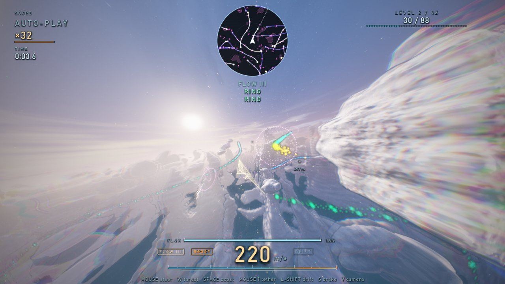
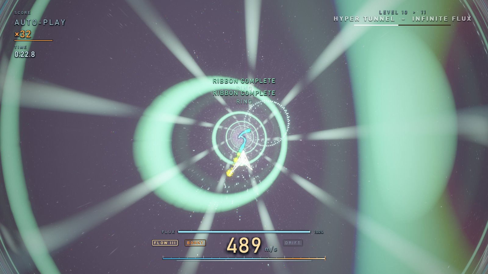
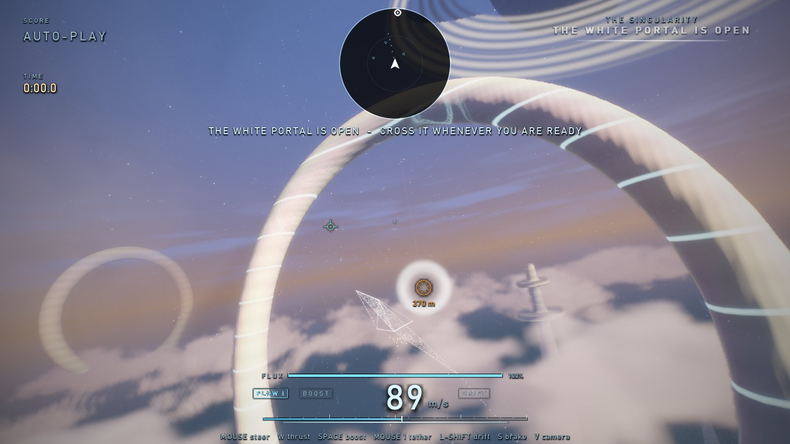

<p align="center"></p>

<h1 align="center">ÉLAN</h1>
<p align="center"><i>momentum is everything</i></p>

<p align="center"></p>

ÉLAN is a 3D inertia glider game. You don't steer a plane so much as keep a fall going: dive to gain speed, skim rock to refuel, skip off the sea, whip around pillars on a tether, and never, ever stop. Every world is generated on the fly and every second of flight burns flux. Run dry and you can only glide, hoping the next ribbon of light is close enough.

## How it flies

- **Flux drains.** Motes, rings, grazing rock and skimming the sea refill it. Out of flux you can only glide, and a stall down at sea level ends the run.
- **Speed multiplies everything.** Chaining pickups builds a wake that cuts drag: FLOW I, II, III. Hard turns bleed speed, so tether around rock to turn for free.
- **The sea is a trampoline and a door.** Hit it at a shallow angle to skip; dive in steep and the glider folds into a dart that charges a SURGE for the launch out.
- **Fill the quota, find the gate, warp.** Each sector ends in a warp tunnel on rails, and every tenth one is a hyper tunnel: three times longer, endless flux, pure speed.

## Worlds

Twelve biomes, each with its own terrain forms, light and mood: EMBER DUSK, GLACIER DAWN, NEON CANYON, TOXIC BLOOM, ABYSSAL REEF, BLOOD MOON, BASALT ORGAN, MIDNIGHT AURORA, MIRROR VOID, VIOLET HOUR, PRISM MANDALA, LIQUID DREAM. The first cycle visits them in order; after that, the deck is shuffled.

<p align="center">




<br><sub>MIDNIGHT AURORA · LIQUID DREAM · MIRROR VOID · GLACIER DAWN</sub>
</p>

<p align="center"><br><sub>A hyper tunnel, every tenth sector</sub></p>

## Modes

| | |
|---|---|
| **CHILL** | Endless sectors, a drain that slowly rises, chase the score. |
| **STORY** | 42 levels, a drain that climbs 1.8× faster, a running clock, one destination. Fall out of the sky and it's back to level 1. |

Both modes can be flown by you (**FLY**) or by the AI pilot (**AUTO-PLAY**), a reinforcement-learned glider that you can hand the controls to and take them back from with F2. AUTO-PLAY runs are never scored.

What waits at the end of STORY is for you to find out.

<p align="center"></p>

## Controls

Everything is rebindable in **OPTIONS → CONTROLS** (two keyboard/mouse slots per action, plus the gamepad).

| Action | Keyboard & mouse | Gamepad |
|---|---|---|
| Steer | Mouse | Left stick (or gyro) |
| Thrust | W / Z | RT |
| Air brake | S / ↓ | LT |
| Strafe | A / Q, D / → | Right stick |
| Boost (burns flux) | Space | RB |
| Tether (hold) | Left click / E | A |
| Drift, cuts lift (hold) | Left Shift | LB |
| Chase / cockpit camera | V | Y |
| Gyro on/off, recenter | | X, B |
| Pause | Esc | Start |
| Restart run | P | |
| AI pilot (AUTO-PLAY runs) | F2 | |
| Stats · fullscreen · screenshot · mute | F3 · F11 · F12 · M | |

## Running it

You need an **NVIDIA GPU** with an up-to-date driver: the whole renderer runs on CUDA. ÉLAN was built and tested on Windows 10 with Python 3.10; other platforms are untested.

```
pip install -r requirements.txt
python main.py
```

The music and the trained AI pilot ship with the repository, so it runs straight after cloning. The first world takes a little while to generate.

Useful options: `--windowed`, `--screen N` (which monitor), `--gpu N`, `--scale 0.75|auto`, `--fps N`, `--vsync`, `--mute`, `--seed N`. The in-game OPTIONS menu covers the rest (render scale, monitor, minimap, camera, volumes, music mode).

## Under the hood

No game engine, no meshes, no textures. Every frame is ray-marched through signed distance fields entirely in PyTorch, worlds are sculpted on the GPU from spectral noise, and Pygame only opens the window, reads the inputs and plays the sound. The soundtrack is generated music split into stems, which an in-game DJ remixes bar by bar to match how you fly. The AI pilot learned by imitation, then by PPO in a batched simulator of the game's own physics.

For a map of the code, see [CODEMAP.md](CODEMAP.md).

## Credits

| | |
|---|---|
| Direction & playtesting | Extraltodeus |
| Design, programming, art, audio, the AI pilot (instructor and student), production, quality assurance, catering | Claude |
| Made with | PyTorch · Pygame · YuE · Demucs · ComfyUI |
| Special thanks | You, for flying |

*No GPUs were harmed. Two were kept very warm.*
